# FastFile Professional

**Version 3.0.5.244**

FastFile Professional is a viewer and line editor for very large plain-text files. It does not load the whole file into memory. On open, it builds a compact line-offset index and reads only the windows it needs. Heavy work runs in the background, and changes are written to a temporary file before they replace the original.

The screenshots below were taken with the English interface, the Notes Plastic skin, and a 165,062-line CSV (about 28.7 million characters) that opened in 133 milliseconds on one read thread. The interface is available in 14 languages.

Each section below is a title, a screenshot, and a short description you can place on the product site.

---

## Open and browse files that are too large for a normal editor

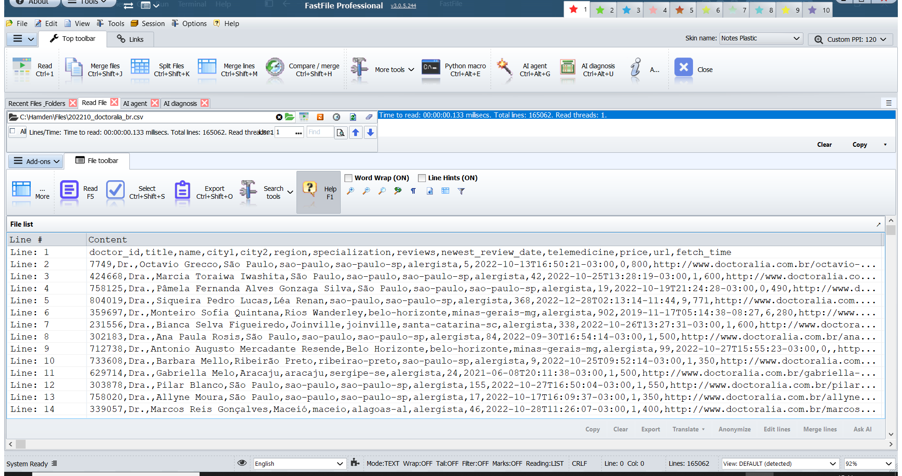

The main workspace shows the file path, the read time, the line count, and the lines themselves. You can move through the file, turn word wrap and line hints on or off, copy or export a selection, translate text, anonymize sensitive values, and edit or merge lines from the same view.

Recent files and folders stay one click away. The status bar reports the encoding, the current line and column, and whether wrap, tail, filter, or bookmarks are active.

---

## Help and feature reference, inside the application

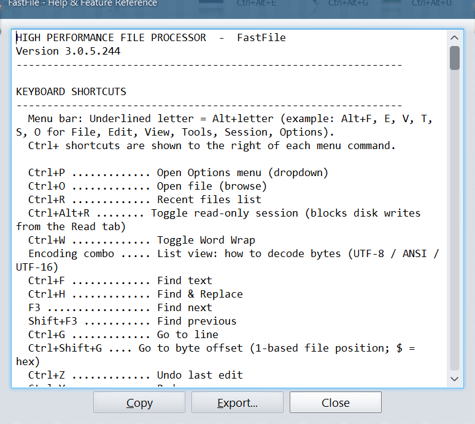

Help (F1) opens a built-in reference for the current version. It lists the menu shortcuts and the commands you use every day: open a file, reopen recent files, switch to a read-only session, find and replace, go to a line or a byte offset, and undo.

The same dialog can be copied or exported, so a team can keep the shortcut list next to the product.

---

## Search tools in one menu

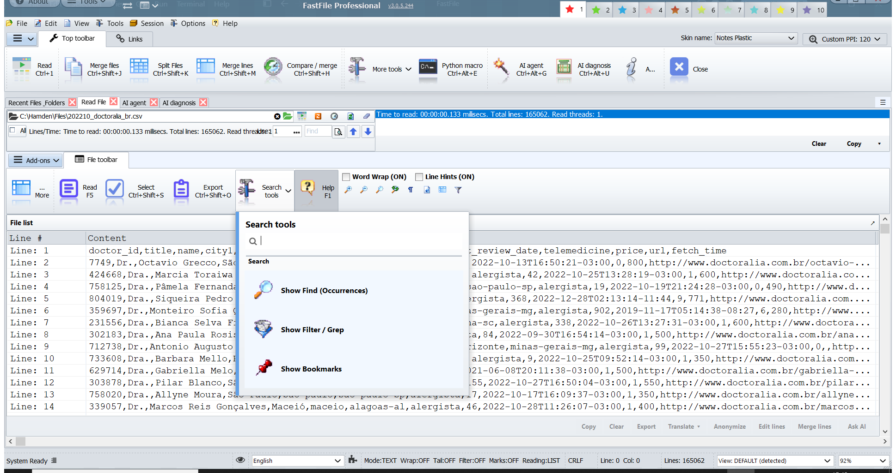

Search tools gathers the three ways to look through an open file:

- **Find (Occurrences)** lists every match, page by page.
- **Filter / Grep** narrows the line list to the rows you care about.
- **Bookmarks** keeps the lines you want to return to.

Each tool also opens the built-in glob and grep command window.

---

## Find every occurrence, then page through the hits

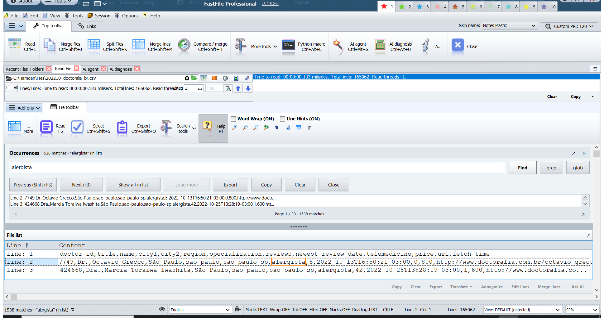

Find Occurrences searches the open file and lists the matching lines with their line numbers. In this example, a search for a specialty name returned 1,538 matches across 39 pages. Previous and Next follow the same shortcuts as a normal find (Shift+F3 and F3). You can load more hits, show them in the file list, copy them, or export them.

The current match stays highlighted in the file list, so you can read the surrounding row without leaving the page.

---

## Filter the line list down to what you need

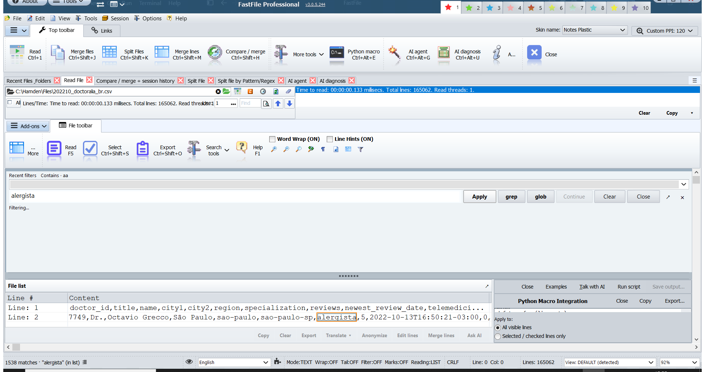

Filter / Grep keeps only the lines that contain the text you type. Recent filters are listed above the box, and Apply runs the search against the open file. The same bar can hand the request to the glob or grep command window.

Here, a contains search for the same specialty left 1,538 matching lines in the list, with the match highlighted in the row. The rest of the file stays on disk. Clearing the filter restores the full line list.

---

## Built-in glob and grep, without a command shell

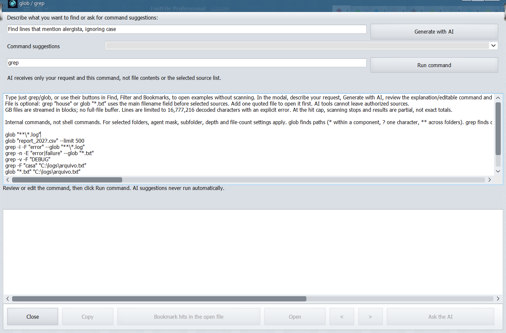

The glob / grep window is FastFile’s own search language. It does not start a shell or an external program. You describe the search in plain language, or you type a command such as a case-insensitive grep, a path glob, or a regular expression.

The window includes ready-made examples: literal text, whole words, inverted matches, searches limited to bookmarked lines, and globs that stay inside one folder or walk subfolders when the source settings allow it. Generate with AI drafts a command from the description. Nothing runs until you choose Run command, and the scan can be cancelled. Results are paged, and Open jumps back to the original line.

---

## Bookmarks for the lines you will need again

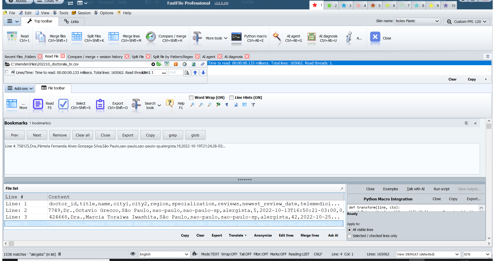

Ctrl+B toggles a bookmark on the current line. The Bookmarks panel lists every saved line, and Prev and Next move between them (F2 and Shift+F2). You can remove one bookmark, clear the set, copy the list, or export it.

Bookmarks also work with grep: a search can mark its hits, or it can search only the lines you have already marked. The open file must already have its line index, and a file can hold up to 10,000 bookmarks.

---

## Compare, merge, and keep a session history

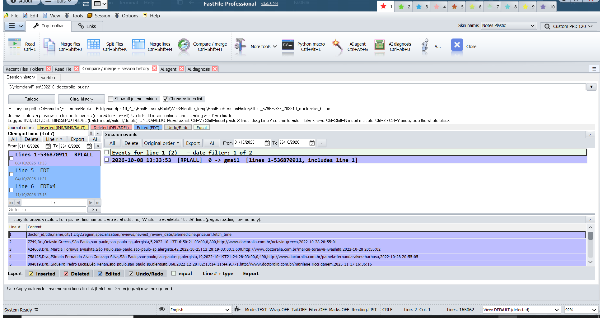

Compare / merge shows what changed between two texts or across the current editing session. Inserted, deleted, edited, and equal lines use separate colors, and undo and redo stay visible in the session log.

The changed-lines list and the session-event list can be filtered by date and by kind of change. A preview shows the file as it looked when the event was recorded. Nothing is written back to disk until you use the Apply actions. Equal rows are left alone.

---

## Split a large file into line ranges

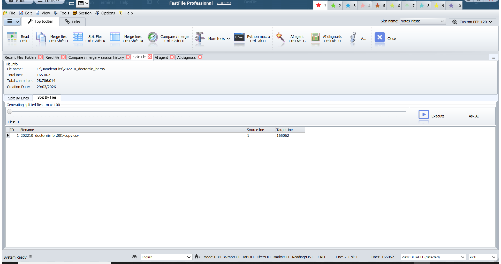

Split by files plans how a large file will be divided before anything is written. The planner shows the source size (here, 165,062 lines and 28,706,014 characters), the output folder, and each planned piece with its line range and name.

You choose how many output files to create, then adjust each piece before anything is written. Confirm is a separate step. Until you take it, the original file is unchanged.

---

## Copy a line range into a new file

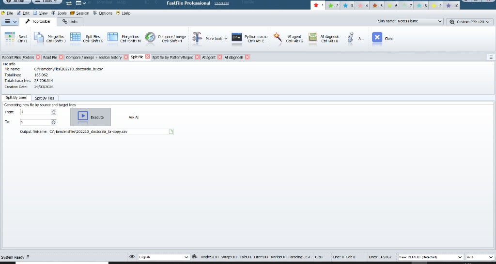

Split by Lines copies one continuous range out of the open file into a new file. The page shows the source path, the line count, the character count, and the creation date, then asks for the first line, the last line, and the output name. In this example the range is lines 1 through 5 of the 165,062-line CSV, written beside the source as a `-copy` file.

From must be at least 1, To must be at least From, and To cannot pass the last line of the file. The output file must have a name, and it must be a different file from the source. If you type only a file name, FastFile saves it in the source folder. Ask AI can look at the current range and the output path before you run anything.

Execute does not load the whole file. It reads the existing line-offset index, maps only the byte range those lines occupy, and writes that slice through a buffered writer on a background thread, with a progress window. The source file is left unchanged. When the write finishes, the same confirmation used by other generated files opens for this one file.

---

## Confirmation after a file is written

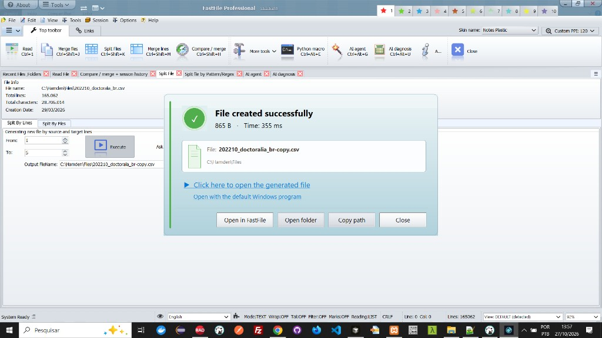

File created successfully is the shared result window for a generated file: a split, an export, or another write that produces a new path. It reports the size and the elapsed time. This run wrote an 865-byte copy in 355 milliseconds.

The file is shown as a card. Click the card, or “Click here to open the generated file,” to open it in FastFile. Open with the default Windows program hands it to the associated application. Open folder shows the containing folder, and Copy path puts the full path on the clipboard (the button then reads Copied). FastFile remembers the last generated file for the session, so you can open this window again from Last generated file. If that file has since been removed, the window says so.

When an operation writes several files, such as the parts of a split, the same window lists them. The title becomes “N files created successfully,” the subtitle shows the total size and the time, and each row can be opened in FastFile. Up to eight files are listed; the rest are counted as additional files in the folder.

---

## Merge files back into one

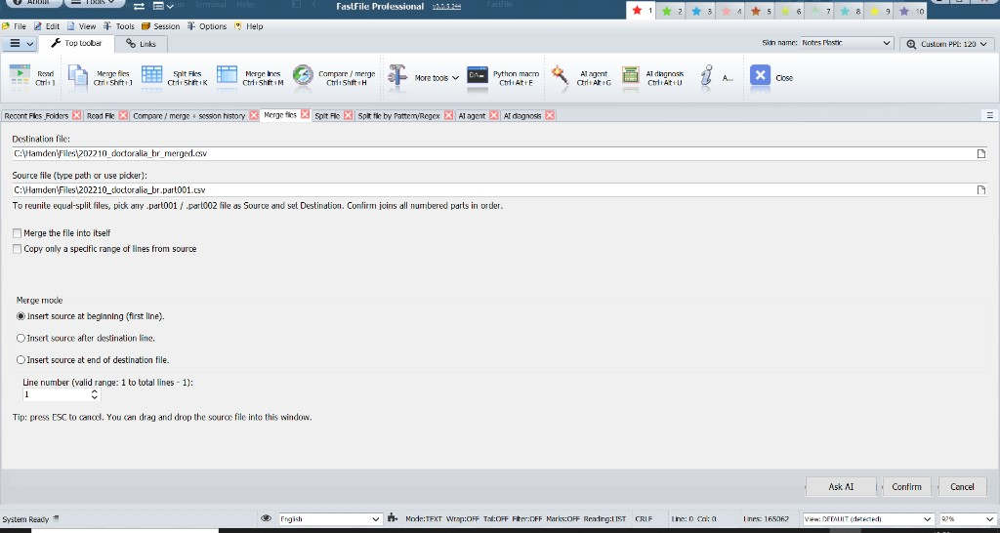

Merge files (Ctrl+Shift+J) inserts a source file into a destination file. You can type either path, pick it, or drag the source onto the window. Esc closes the page without writing.

Three positions are available: at the first line, after a destination line, or at the end of the destination. “After a line” uses the destination’s line index, so the destination must already be open and must have at least two lines. The line you choose must fall between 1 and the last line minus one. Merge the file into itself uses the destination as the source and locks the source field. Copy only a specific range of lines takes a From and To on the source; both ends are checked against that file’s real line count, and the range is what gets inserted.

If the source name is a numbered part such as `.part001` or `.part002`, Confirm does not insert that one file. It finds the consecutive siblings in the same folder (`.part001`, `.part002`, and so on), asks you to join them in order, and writes the result to the destination. If that destination already exists, FastFile asks before replacing it. A single leftover part is not treated as a set.

A normal merge checks that both files exist and can be opened, estimates the disk space the write will need, and keeps an undo backup before the background merge starts. Inserting at the end can append directly. Any other position is written to a temporary file and then replaces the destination. When it finishes, FastFile refreshes the open file and offers a short summary. Ask AI can review the destination, the source, the line range, and the insert position before you confirm.

---

## Split when a line matches a pattern

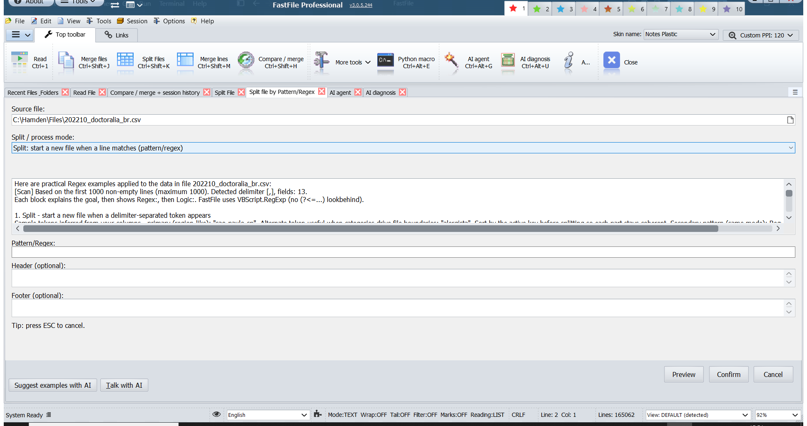

Split by Pattern/Regex starts a new output file whenever a line matches a delimiter or a regular expression. FastFile samples the file (the first 1,000 non-empty lines in this view), detects a comma-separated layout, and names the engine it will use (VBScript.RegExp, without lookbehind).

Suggest elements with AI can propose the pattern. Preview shows the planned split. Confirm is required before any file is created.

---

## More tools for splitting, extracting, and finding files

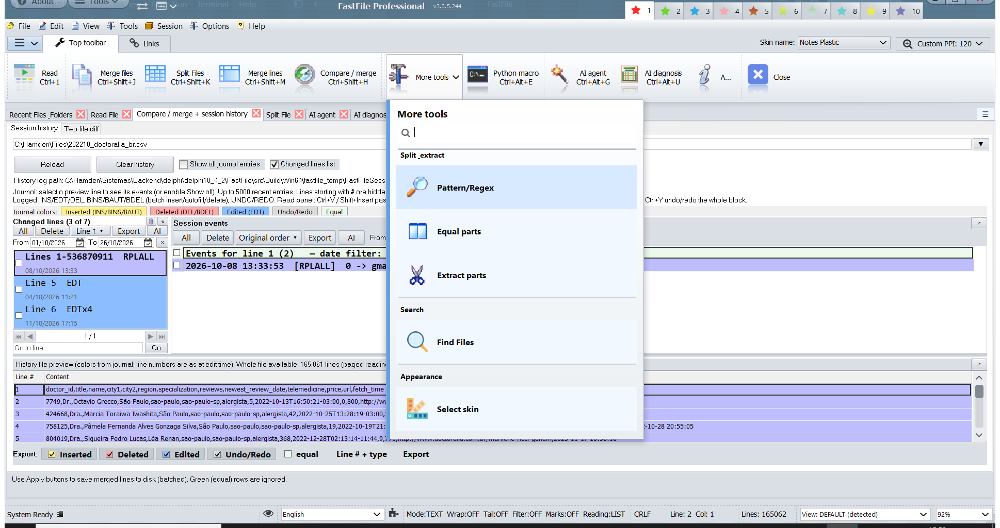

More tools groups the operations that sit beside the main toolbar:

- **Pattern / Regex, Equal parts, and Extract parts** divide or pull sections out of a large file.
- **Find Files** searches folders by name.
- **Select skin** changes the visual theme. The screenshots on this page use Notes Plastic.

---

## Python macros on the lines you can see

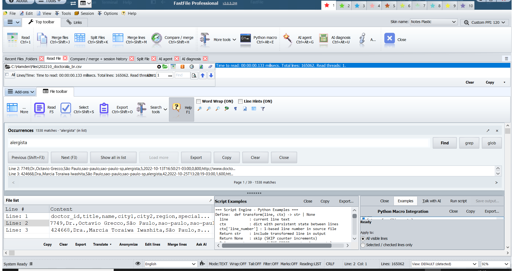

Python Macro Integration runs a `transform(line, ctx)` function over the open file. `line` is the current text. `ctx` carries state from one line to the next, including the 1-based line number. Return a string to keep the transformed line, or return nothing to drop it.

Script Examples shows the contract next to the editor. You choose whether the script applies to every visible line or only to the lines you selected. Talk with AI can help you write the script. Run script is a separate action, and the output can be saved when you are ready.

---

## AI diagnosis that only reads

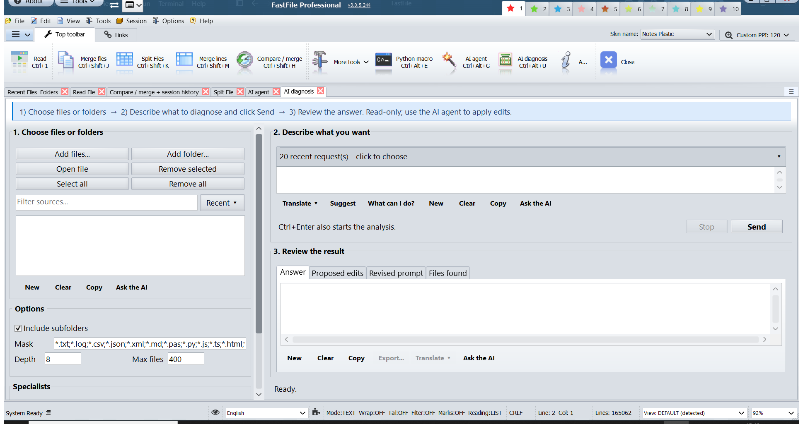

AI diagnosis answers questions about files and folders you choose. You describe the question, set the folder depth, the file mask, and the maximum number of files, and include or skip subfolders.

The review area separates the answer, any proposed edits, the revised prompt, and the files that were found. Diagnosis does not change those files. Applying an edit is a different tool: the AI agent, and only after you accept the proposal.

---

## An AI agent that proposes changes and waits for you

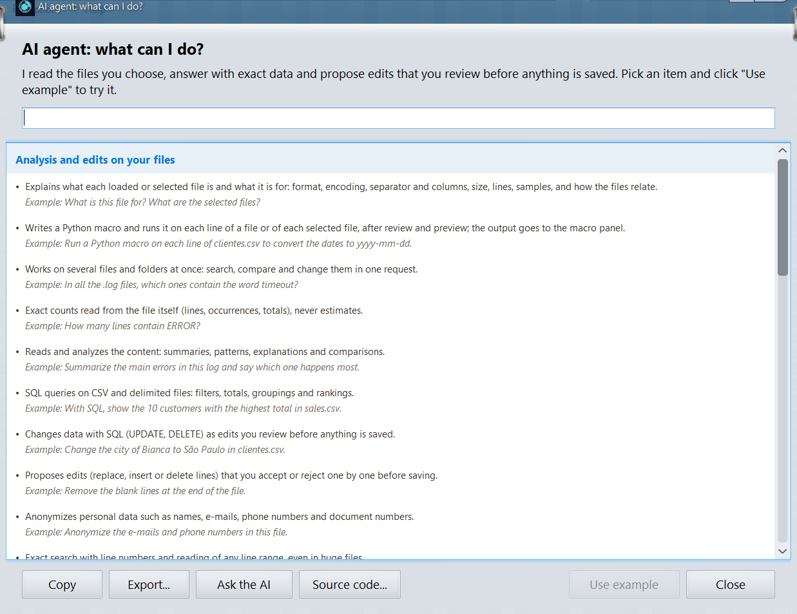

The AI agent can explain a file, write or adjust a Python macro, work across the files you selected, count matches exactly, summarize a layout, draft SQL, propose line edits, and anonymize values. “What can I do?” lists those jobs in the language of the interface, each with a short example.

Proposed edits stay proposals. You review them before anything is saved. The agent’s file access follows the sources you selected. An explicit file in a command can narrow that list. It does not open files you did not authorize.

---

## Also on the main toolbar

These actions are on the same workspace and use the same rule: plan and review first, then write.

| Action | What it is for |
|---|---|
| Merge lines | Combine selected lines in the open file. |
| Export | Copy the current view or a result list out of FastFile. |
| Anonymize | Mask sensitive values in the lines you choose. |
| Read-only session | Browse and search with disk writes blocked (Ctrl+Alt+R). |
| Skins and languages | Notes Plastic is one of the skins. The interface ships in 14 languages. |
