# FastFile Professional

**Version 3.0.5.274**

FastFile Professional is a viewer and line editor for very large plain-text files. It does not load the whole file into memory. On open, it builds a compact line-offset index and reads only the windows it needs. Heavy work runs in the background, and changes are written to a temporary file before they replace the original.

The screenshots below were taken with the English (United States) interface and the Notes Plastic skin. Several views use a 165,062-line CSV that opened in about 144 milliseconds on one read thread. The interface is available in 30 languages.

Each section below is a title, a screenshot, and a short description you can place on the product site.

---

## Main form — ready for a huge file

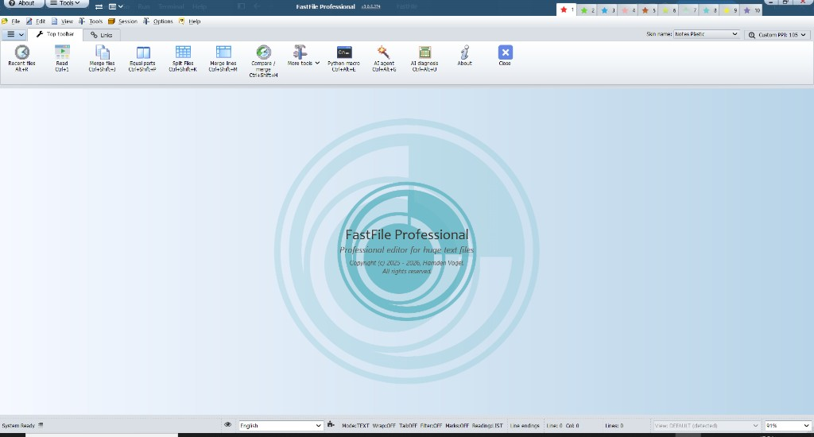

The main form is the home screen when no file is open yet. The center shows the FastFile Professional mark and tagline. The top toolbar keeps the daily actions in one place: Recent files, Read, Merge files, Equal parts, Split files, Merge lines, Compare / merge, More tools, Python macro, AI agent, AI diagnose, and About.

The status bar reports system ready state, the UI language, mode (TEXT), wrap, tail, filter, bookmarks, reading mode, line and column, line count, view encoding, and zoom. Skin and custom PPI sit on the right of the toolbar so you can match the look to your monitor before you open a file.

---

## Recent files tab — pick up where you left off

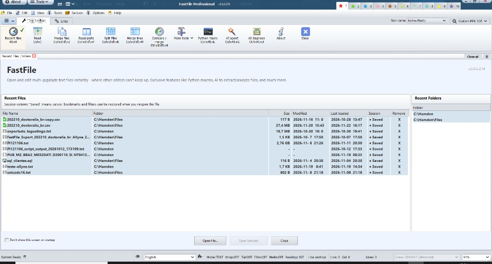

**Recent files (Alt+R)** opens a welcome-style tab with two lists: recent files on the left and recent folders on the right. Each file row shows name, folder, size, modified time, last loaded time, and a Session column. **Saved** means cursor position, bookmarks, and filters can be restored when you reopen that file. Use the **X** on a row to remove it from the list.

From here you can **Open File…**, **Open Selected**, or **Close** the tab. Check **Don't show this screen on startup** if you prefer to land on the idle main form instead. The same top toolbar stays available so you can jump straight into Read, merge, split, Python macro, or the AI tools.

---

## Read file tab — browse a huge file without loading it all

**Read** opens the **Read File** tab around the file you chose. The path bar, read time, total line count, and read-thread count sit above the list. In this shot a 165,062-line CSV opened in 144 milliseconds on one thread.

The **File toolbar** keeps the day-to-day line tools close: Read (F5), Select, Export, Search tools, Help, plus Word Wrap, Line Hints, and AI Assistant. The line list shows numbered rows you can select, copy, export, translate, anonymize, or edit without pulling the whole file into memory. Find and thread controls stay on the same strip so you can search and retune the read without leaving the tab.

---

## Help and feature reference, inside the application

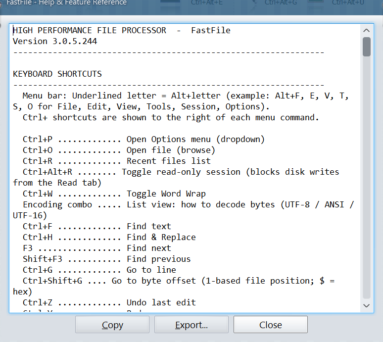

Help (F1) opens a built-in reference for the current version. It lists the menu shortcuts and the commands you use every day: open a file, reopen recent files, switch to a read-only session, find and replace, go to a line or a byte offset, and undo.

The same dialog can be copied or exported, so a team can keep the shortcut list next to the product.

---

## Search tools in one menu

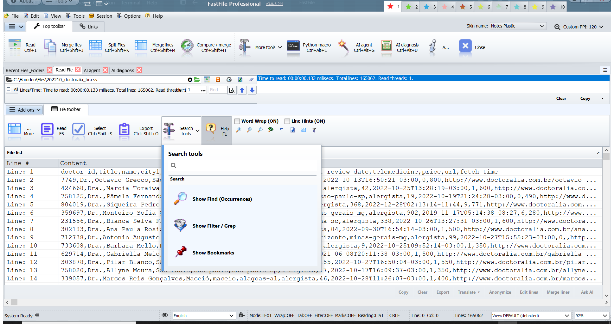

Search tools gathers the three ways to look through an open file:

- **Find (Occurrences)** lists every match, page by page.
- **Filter / Grep** narrows the line list to the rows you care about.
- **Bookmarks** keeps the lines you want to return to.

Each tool also opens the built-in glob and grep command window.

---

## Read file tab with Find (Occurrences) panel

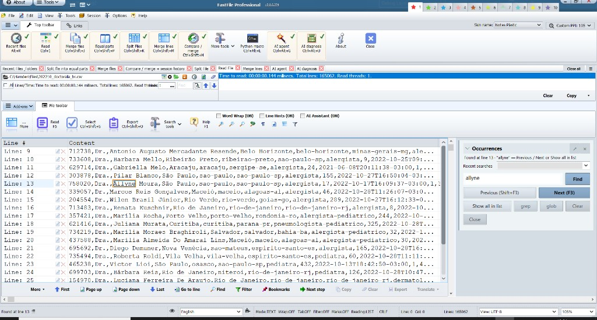

On the **Read File** tab, **Find** opens the **Occurrences** panel beside the line list. Type a term, click **Find**, then use **Previous (Shift+F3)** and **Next (F3)** to walk the hits. **Show all in list** builds the full match list; **grep** and **glob** jump to the command window; **Clear** and **Close** reset or dismiss the panel.

In this shot a search for `allyne` lands on line 13, with the match highlighted in the row while the surrounding CSV lines stay visible. The status bar echoes the same “Found at line …” message so you can keep reading without leaving the file.

---

## Filter — keep only the lines that match

**Filter** narrows the **Read File** line list to rows that contain the text you typed. The funnel control stays active while a filter is on; line numbers in the list stay the original file indices, so you still know where each hit lives. The rest of the file stays on disk.

In this example the filter is `ana paula`. Only matching CSV rows remain visible (for example lines 8, 839, 977, …), each containing that name. Clear the filter to restore the full 165,062-line list. Export and the other line tools still apply to the filtered view.

---

## Built-in glob and grep, without a command shell

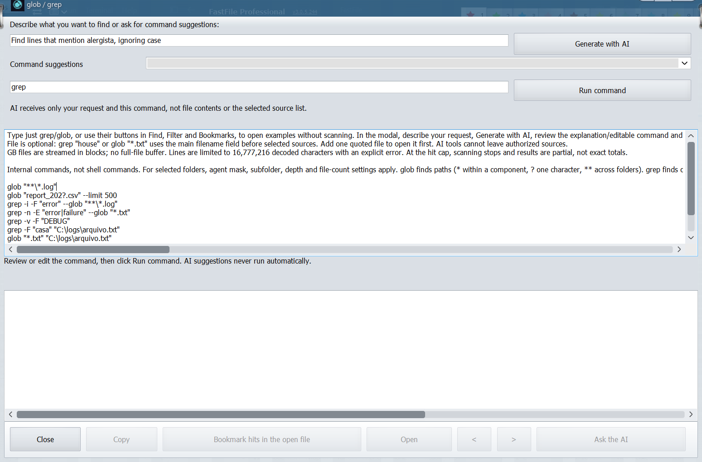

The glob / grep window is FastFile’s own search language. It does not start a shell or an external program. You describe the search in plain language, or you type a command such as a case-insensitive grep, a path glob, or a regular expression.

The window includes ready-made examples: literal text, whole words, inverted matches, searches limited to bookmarked lines, and globs that stay inside one folder or walk subfolders when the source settings allow it. Generate with AI drafts a command from the description. Nothing runs until you choose Run command, and the scan can be cancelled. Results are paged, and Open jumps back to the original line.

---

## Bookmarks for the lines you will need again

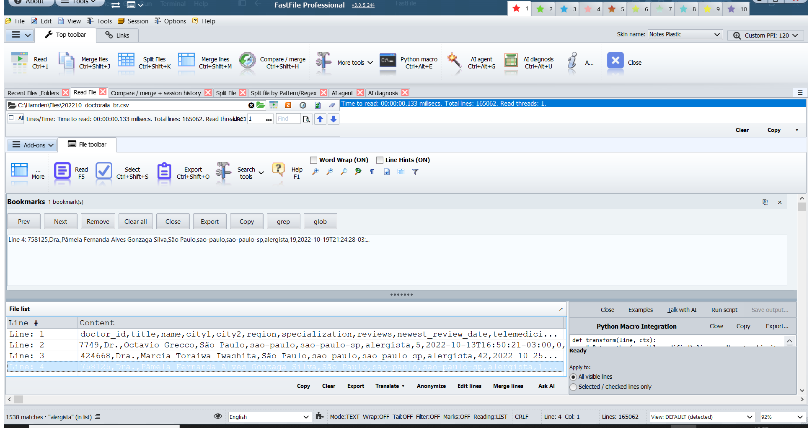

Ctrl+B toggles a bookmark on the current line. The Bookmarks panel lists every saved line, and Prev and Next move between them (F2 and Shift+F2). You can remove one bookmark, clear the set, copy the list, or export it.

Bookmarks also work with grep: a search can mark its hits, or it can search only the lines you have already marked. The open file must already have its line index, and a file can hold up to 10,000 bookmarks.

---

## Compare / merge tab — session history and apply

**Compare / merge (Ctrl+Shift+H)** opens the **Compare / merge + session history** tab. Pick the file, **Reload** or **Clear history**, and optionally show all session log entries or **Changed lines only**. A color legend marks Inserted, Deleted, Edited, Undo/Redo, and Equal.

The left list is **Changed lines**; the right list is **Session events** for the selected line (with a date filter). Below that, **History file preview** colors the surrounding rows so you can see edits in context. Export filters (Inserted, Deleted, Edited, Undo/Redo, equal) sit under the preview. Nothing is written back to disk until you use the **Apply** actions; green (equal) rows are ignored.

---

## Split a large file into line ranges

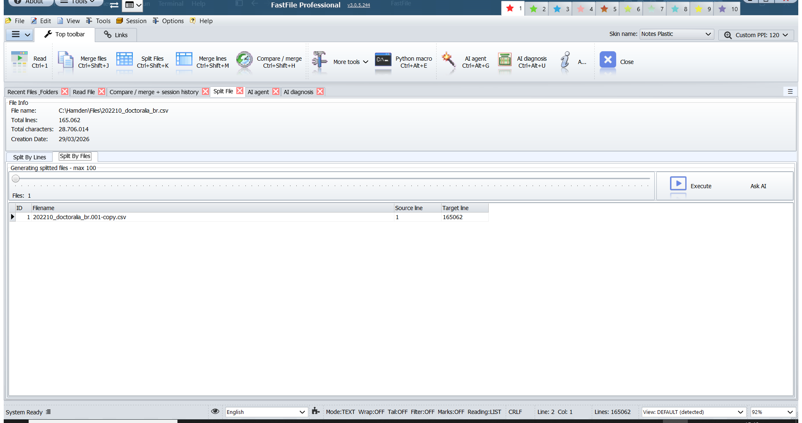

Split by files plans how a large file will be divided before anything is written. The planner shows the source size (here, 165,062 lines and 28,706,014 characters), the output folder, and each planned piece with its line range and name.

You choose how many output files to create, then adjust each piece before anything is written. Confirm is a separate step. Until you take it, the original file is unchanged.

---

## Split files tab — copy a line range into a new file

**Split files (Ctrl+Shift+K)** opens the **Split File** tab. **Split by Lines** copies one continuous range out of the open file into a new file. File Info shows the source path, total lines, total characters, and creation date. You set **From**, **To**, and the output file name. In this shot the range is lines 1 through 20,000 of the 165,062-line CSV (about 12% of the file), written beside the source as a `-copy` file. A preview lists the first lines of that range, with the same line tools as elsewhere (Copy, Clear, Export, Translate, Anonymize, Edit lines, Merge lines, Ask AI).

From must be at least 1, To must be at least From, and To cannot pass the last line of the file. The output file must have a name, and it must be a different file from the source. If you type only a file name, FastFile saves it in the source folder. **Ask AI** can review the current range and the output path before you run anything.

**Execute** does not load the whole file. It reads the existing line-offset index, maps only the byte range those lines occupy, and writes that slice through a buffered writer on a background thread, with a progress window. The source file is left unchanged. When the write finishes, the same confirmation used by other generated files opens for this one file.

---

## Confirmation after a file is written

File created successfully is the shared result window for a generated file: a split, an export, or another write that produces a new path. It reports the size and the elapsed time. This run wrote an 865-byte copy in 355 milliseconds.

The file is shown as a card. Click the card, or “Click here to open the generated file,” to open it in FastFile. Open with the default Windows program hands it to the associated application. Open folder shows the containing folder, and Copy path puts the full path on the clipboard (the button then reads Copied). FastFile remembers the last generated file for the session, so you can open this window again from Last generated file. If that file has since been removed, the window says so.

When an operation writes several files, such as the parts of a split, the same window lists them. The title becomes “N files created successfully,” the subtitle shows the total size and the time, and each row can be opened in FastFile. Up to eight files are listed; the rest are counted as additional files in the folder.

---

## Merge files tab — join parts or insert a source

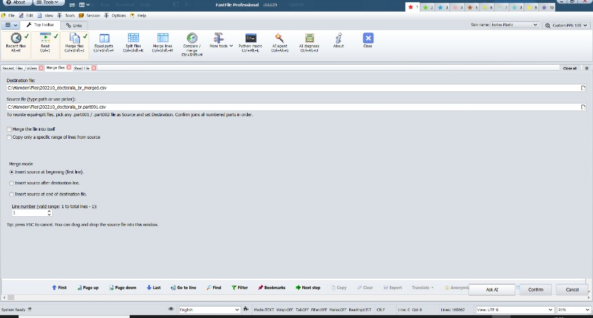

**Merge files (Ctrl+Shift+J)** opens its own tab. Set a **Destination file** and a **Source file** (type the path, use the picker, or drag the source onto the window). Esc closes the tab without writing.

Three insert modes are available: at the beginning (first line), after a destination line, or at the end of the destination. “After a line” uses the destination’s line index, so the destination must already be open and must have at least two lines. The line you choose must fall between 1 and the last line minus one. **Merge the file into itself** uses the destination as the source and locks the source field. **Copy only a specific range of lines** takes a From and To on the source; both ends are checked against that file’s real line count, and the range is what gets inserted.

To reunite equal-split files, pick any `.part001` / `.part002` file as Source and set Destination. Confirm then finds the consecutive siblings in the same folder, joins them in order, and writes the result. If that destination already exists, FastFile asks before replacing it. A single leftover part is not treated as a set.

A normal merge checks that both files exist and can be opened, estimates the disk space the write will need, and keeps an undo backup before the background merge starts. Inserting at the end can append directly. Any other position is written to a temporary file and then replaces the destination. When it finishes, FastFile refreshes the open file and offers a short summary. **Ask AI**, **Confirm**, and **Cancel** sit on the tab so you can review the plan before anything is written.

---

## Merge lines tab — stage line replacements, then write

**Merge lines (Ctrl+Shift+M)** opens a tab where you stage replacements by line number before anything hits disk. The note at the top states the working limit (default **1000** lines). Enter a **Line Number** and the new **Content**, then **Add/Update** to put the row in the list. Select a row to edit it again. **Copy** and **Remove** manage the staged rows; **Merge** applies them to the open file; **Cancel** discards the tab work without writing.

In this shot three CSV rows are staged (lines 5, 6, and 9) with full replacement text ready. Use this when you already know which line numbers must change and want a clear review list before the write.

---

## Split when a line matches a pattern

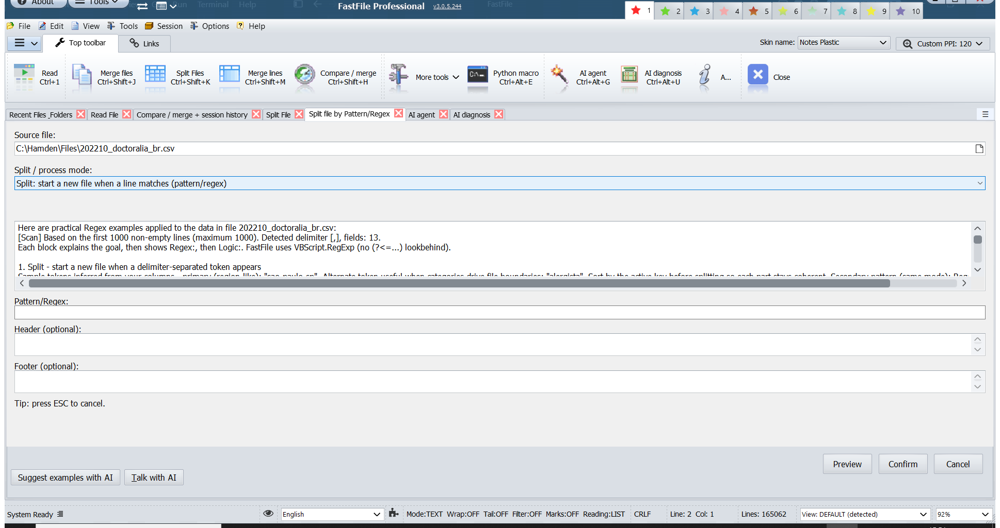

Split by Pattern/Regex starts a new output file whenever a line matches a delimiter or a regular expression. FastFile samples the file (the first 1,000 non-empty lines in this view), detects a comma-separated layout, and names the engine it will use (VBScript.RegExp, without lookbehind).

Suggest elements with AI can propose the pattern. Preview shows the planned split. Confirm is required before any file is created.

---

## More tools for splitting, extracting, and finding files

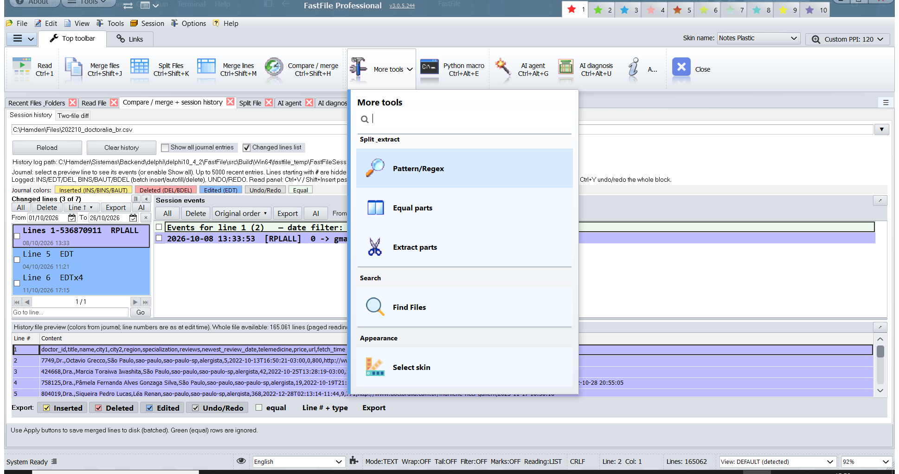

More tools groups the operations that sit beside the main toolbar:

- **Pattern / Regex, Equal parts, and Extract parts** divide or pull sections out of a large file.
- **Find Files** searches folders by name.
- **Select skin** changes the visual theme. The screenshots on this page use Notes Plastic.

---

## Python macros on the lines you can see

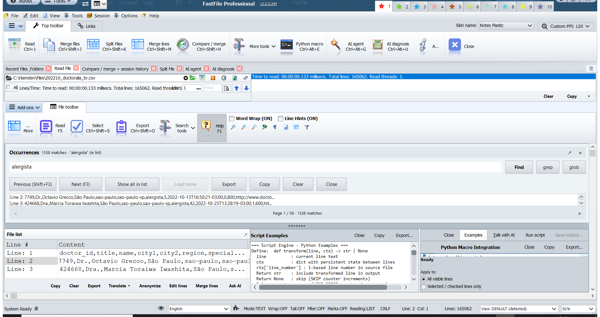

Python Macro Integration runs a `transform(line, ctx)` function over the open file. `line` is the current text. `ctx` carries state from one line to the next, including the 1-based line number. Return a string to keep the transformed line, or return nothing to drop it.

Script Examples shows the contract next to the editor. You choose whether the script applies to every visible line or only to the lines you selected. Talk with AI can help you write the script. Run script is a separate action, and the output can be saved when you are ready.

---

## AI diagnosis tab — read-only review of files and folders

**AI diagnosis (Ctrl+Alt+U)** follows three steps: **1)** choose files or folders, **2)** describe what to diagnose and **Send**, **3)** review the answer. Sources sit on the left with mask, depth, max files, and include-subfolders. **Specialists** (Inventory, Content, Structure, SQL / tabular, and related checks) focus the review. The prompt area keeps recent requests, **Stop** / **Send**, and shortcuts such as Translate, Suggest, and **What can I do?**.

Results use **Answer**, **Proposed edits**, **Revised prompt**, and **Files found**. Diagnosis itself does not change those files. Applying an edit belongs to the **AI agent**, and only after you accept the proposal.

---

## AI agent tab — ask, review, then accept edits

**AI agent (Ctrl+Alt+G)** follows three steps on one tab: **1)** add files or folders, **2)** describe what you want and **Send**, **3)** read the answer and review edits. Sources sit on the left (Add files/folder, filter, Recent, include subfolders, file mask, max depth, max files). The prompt area keeps recent requests, **Stop** / **Chat** / **Send**, and shortcuts such as Translate, Suggest, and **What can I do?**.

Results use four panes: **Answer**, **Proposed edits**, **Revised prompt**, and **Files found**. In this shot the agent explains a Doctoralia Brazil CSV export without changing the file. Proposed edits stay proposals until you accept them. Access follows the sources you selected; naming a file in the command can narrow that list. It does not open files you did not authorize.

---

## Also on the main toolbar

These actions are on the same workspace and use the same rule: plan and review first, then write.

| Action | What it is for |
|---|---|
| Export | Copy the current view or a result list out of FastFile. |
| Anonymize | Mask sensitive values in the lines you choose. |
| Read-only session | Browse and search with disk writes blocked (Ctrl+Alt+R). |
| Skins and languages | Notes Plastic is one of the skins. The interface ships in 30 languages. |
