# FastFile Professional

**Version 3.0.5.274** · **Professional editor for huge text files**

## Built for files that stall ordinary editors

**FastFile Professional** is a native Windows desktop product for multi-gigabyte logs, CSV/TSV exports, SQL dumps, and other production extracts. It does not load the whole file into RAM. A compact **line-offset index** and **memory-mapped I/O (MMF)** let you open, scroll, search, and edit only the windows you need — so a very large file can stay responsive on a normal workstation.

It is aimed at **analysts, DBAs, developers, and support teams**: **atomic writes** (temp file, then swap), a full **session history**, **Python macros**, an **AI agent that writes only after you accept**, **AI diagnosis** that only reads, **data anonymization** with preview and undo, and a **30-language** UI with **RTL** for Arabic and Hebrew.

In the gallery below, a **165,062-line** CSV opens in about **131–144 ms** on one read thread — the same path that scales well past what fits in memory.

---

## Key product topics

Site-ready chips / hero badges (short labels). Use as-is on cards, comparison rows, or the feature strip.

| Topic | One-line meaning |
|---|---|
| **TB / GB Files — Full Edition** | Open, scroll, search, and edit multi-gigabyte (and larger) text without loading the whole file into RAM |
| **Strong AI Support** | AI diagnosis (read-only) + AI agent (proposals first; write only after you accept) |
| **Full Python Integration** | `transform(line, ctx)` macros, Script Examples, preview, Tail macros on growing files |
| **30 Languages — Fully Translated** | Complete UI in 30 languages, including Arabic and Hebrew with RTL chrome |
| **MMF + Line Index Engine** | Memory-mapped I/O and a compact line-offset index for the visible window only |
| **Zero Scan / Instant Open** | Open huge files fast when a full pre-scan is too costly |
| **Review Before Write** | Previews and proposals first; disk updates use temp file + atomic swap |
| **Atomic Safe Edits** | Background work, undo / session log, recoverable mid-edit path |
| **Anonymize with Preview** | Same-shaped fakes for numbers, dates, emails, codes, names — side by side before commit |
| **Session History** | Save / load, read-only session, before/after on changes, exportable history |
| **CSV / Column Mode** | Delimited files as a grid; optional AI help on column layout |
| **Split · Merge · Compare** | Equal parts, split by lines/pattern, merge files/lines, compare + history apply |
| **Search Suite Built In** | Find, Occurrences, Filter, Bookmarks, and glob/grep — no external shell required |
| **Select (Checkbox) Mode** | Tick lines for export, translate, anonymize, edit, merge, Ask AI, and Python macros |
| **Native Windows Desktop** | Delphi / Win32–Win64 app with AlphaSkins and Custom PPI (not a web wrapper) |
| **Skins + Custom PPI** | AlphaSkins (e.g. Notes Plastic) and per-app UI scale for high-DPI monitors |

**Suggested hero chip strip (short):**  
`TB/GB Files` · `Strong AI` · `Full Python` · `30 Languages` · `Review Before Write` · `Native Windows`

---

## What you get in practice

| Need | How FastFile helps |
|---|---|
| Open a large file without waiting forever | Line index + MMF; **Zero Scan / Instant Open** when a full pre-scan is too costly |
| Edit without risking a half-written original | Background work, **atomic rewrite**, undo / session log, recoverable mid-edit path |
| Search and narrow the view | Find, Filter, Bookmarks, built-in **glob/grep**, segmented heavy ops for large replaces |
| Split, merge, compare | Equal parts, Split by lines / pattern, Merge files, Merge lines, Compare / merge + history |
| Automate and ask | Python `transform(line, ctx)`, Tail macros, **AI agent** (proposals first), **AI diagnosis** (read-only) |
| Prepare shareable data | **Anonymize** with consistent keys, header options, column rules, estimated undo size |
| Work in your language | **30 UI languages**, recent-language picker with flags, **RTL chrome** with LTR file text |

Most editors try to own the entire buffer. FastFile owns the **index and the visible window**, then builds the rest of the suite on that foundation.

---

## Strengths worth highlighting

- **Large files without a full RAM load** — Index by line; map what is on screen. Instant Open / Zero Scan when a dense first pass is not practical.
- **Review before write** — Splits, anonymize, Python preview, and AI proposals show the plan first. Disk updates use temp + swap; equal rows stay untouched on apply.
- **Search in one place** — Occurrences, Filter, Bookmarks, and glob/grep stay inside the app; grep can mark hits or search only marked lines.
- **Toolbar file tools** — Merge files, Equal parts, Split files, Merge lines, Pattern/Regex, Extract Frequent Strings, Delete Duplicate Lines.
- **Python on the open lines** — Script Examples beside the editor; all visible or selected/checked lines; Tail can transform new lines as they arrive.
- **Clear AI roles** — Diagnosis explains; the agent proposes. You choose the sources; nothing is written until you accept.
- **Anonymize with a preview** — Numbers, dates, emails, codes, and names, side by side, before commit.
- **Session and history** — Save/load, read-only session, before/after on changes, exportable history.
- **CSV / Column mode** — Delimited files as a grid; optional AI help on column layout.
- **Skins, scale, locale** — AlphaSkins (e.g. Notes Plastic), Custom PPI, 30 languages, RTL for Arabic and Hebrew.

---

## Screenshot gallery

Screenshots use the **English (United States)** UI and the **Notes Plastic** skin. Each section is a title, an image, and a short description for the product site.

---

## 01 — Main form

The home screen before a file is open: product mark, tagline, and the **top toolbar** (Recent files, Read, Merge files, Equal parts, Split files, Merge lines, Compare / merge, More tools, Python macro, AI agent, AI diagnose, About). The status bar shows language, mode, wrap, tail, filter, bookmarks, line/column, encoding, and zoom. Skin and Custom PPI sit on the right so you can set look and scale first.

---

## 02 — Recent files

**Recent files (Alt+R)** lists recent files and folders. Columns cover name, folder, size, modified, last loaded, and **Session** — **Saved** means cursor, bookmarks, and filters can restore on reopen. Open File…, Open Selected, or Close; optionally hide this screen on startup.

---

## 03 — Read file

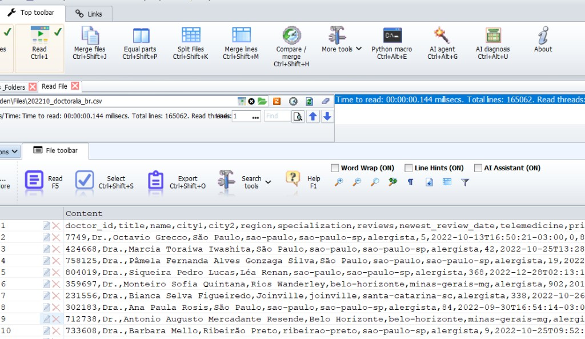

**Read** opens the file in **Read File**: path, read time, line count, and thread count above the list. This 165,062-line CSV opened in **144 ms** on one thread. The File toolbar keeps Read (F5), Select, Export, Search tools, Help, Word Wrap, Line Hints, and AI Assistant next to the numbered lines — without loading the whole file into memory.

---

## 04 — Word Wrap

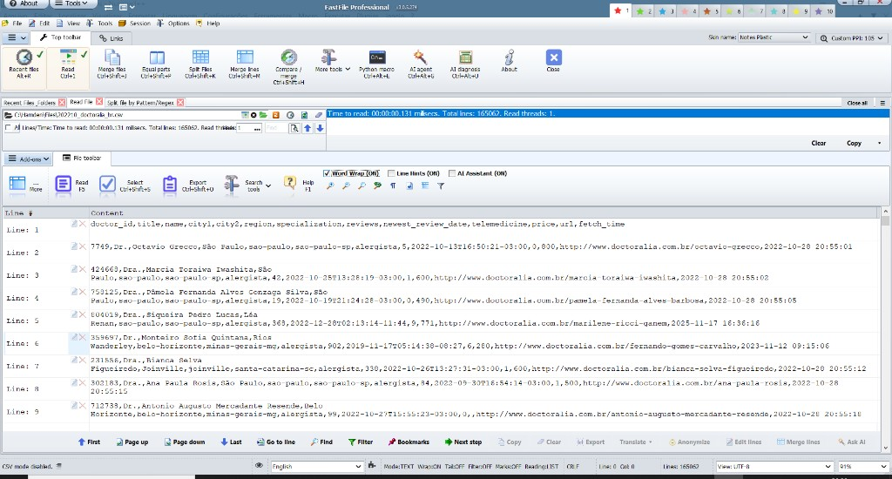

**Word Wrap (Ctrl+W)** folds long lines inside each row so wide CSV cells and URLs stay readable. The toolbar shows **Word Wrap (ON)**; the status bar shows **Wrap: ON**. One logical line still maps to one line number. Turn wrap off for a single horizontal line per row.

---

## 05 — Select (checkbox list)

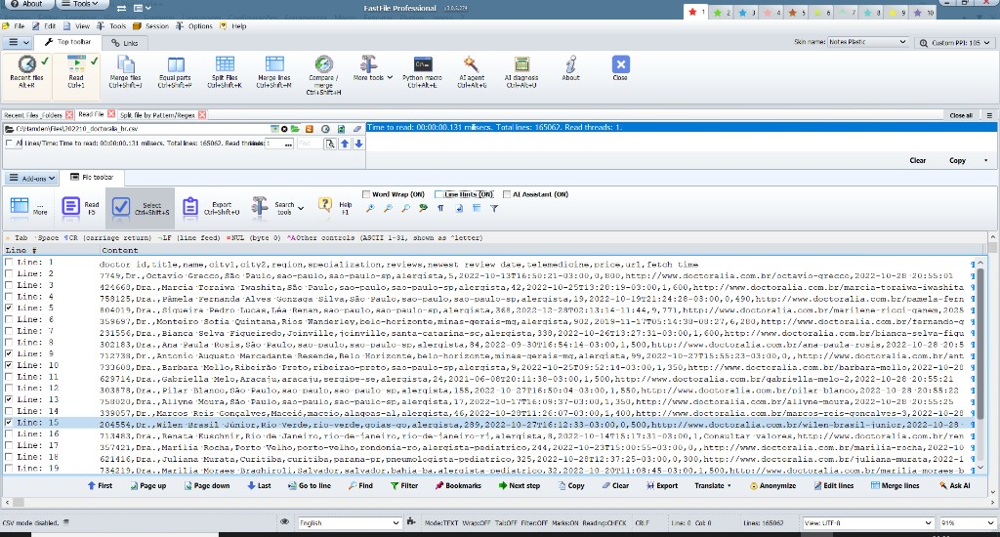

**Select (Ctrl+Shift+S)** adds a checkbox per row (**Reading: CHECK**). Tick the lines you need (here 5, 10, and 15); Export, Translate, Anonymize, Edit lines, Merge lines, Ask AI, and Python macros can target that set. Available on the File toolbar and under **View › Select (checkbox list)**.

---

## 06 — Context menu

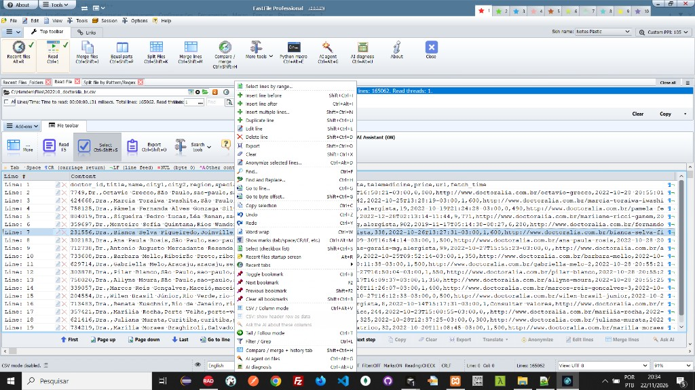

Right-click a row for the **context menu**: insert/edit/delete lines, export, anonymize, find/replace, go to line or offset, wrap, Select, bookmarks, CSV mode, Tail, Filter, Compare / merge, and AI commands — with shortcuts listed. Useful when focus is already on the list.

---

## 07 — UI scale (PPI)

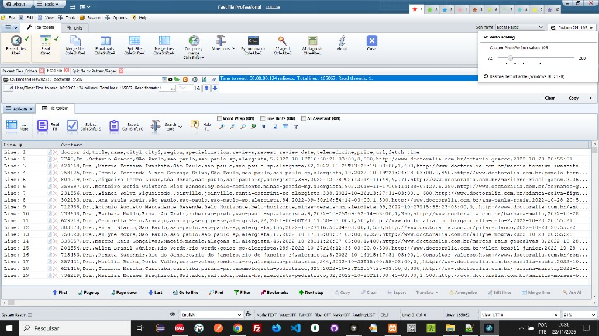

**Auto scaling** next to the skin sets **Custom PPI** (72–288; here 105) or restores Windows DPI. Preferences can store the same default (0 = system DPI). Adjust FastFile alone when the UI feels too small or large on a high-DPI monitor.

---

## 08 — 30 UI languages

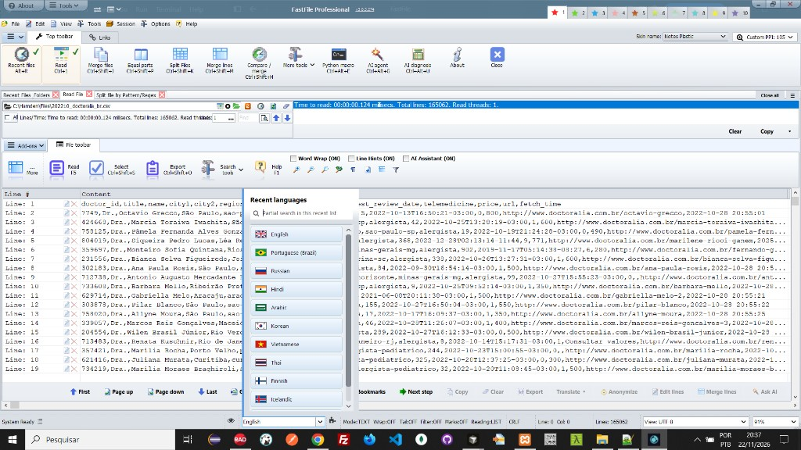

The status-bar language control opens **Recent languages** — searchable, with flags. FastFile ships **30 UI languages** (including English, Portuguese BR/PT, Spanish, French, German, Italian, Polish, Romanian, Hungarian, Czech, Japanese, Simplified/Traditional Chinese, Arabic, Hebrew, Hindi, Russian, Korean, Dutch, Turkish, Ukrainian, Thai, Greek, Norwegian, Swedish, Danish, Icelandic, Finnish, Vietnamese). Arabic and Hebrew use RTL chrome; file text stays LTR. The list closes while the language loads.

---

## 09 — Right-to-left (RTL) UI

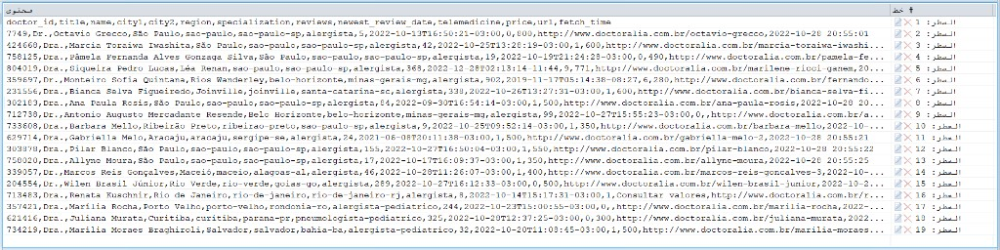

In **Arabic** or **Hebrew**, forms and chrome mirror (RTL / BiDi). Headers and line labels sit on the right; in this Arabic view, **السطر** / **محتوى** mark line and content. **File text stays left to right** so CSV and URLs remain readable. Switch to any LTR language to restore the default layout.

---

## 10 — Help, About, and license

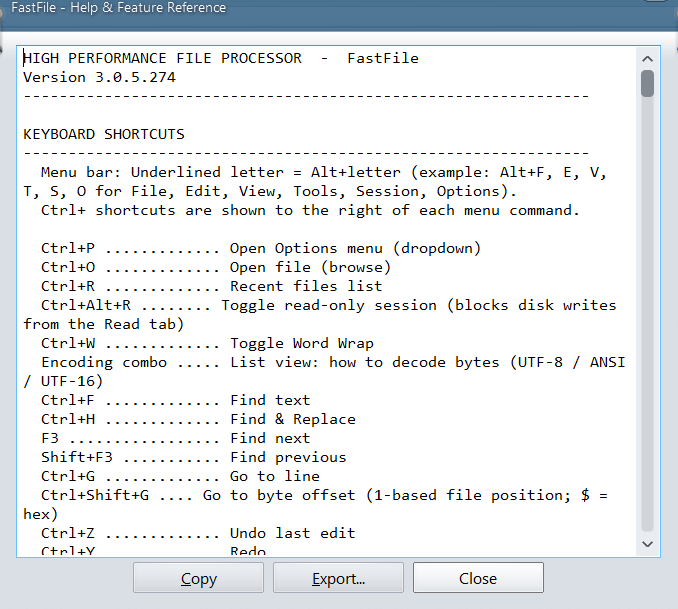

**Help (F1)** opens **Help & Feature Reference** for the current build (**3.0.5.274**): shortcuts for open, recent files, read-only session, wrap, find/replace, go to line/offset, undo/redo, and more. **Copy** and **Export…** keep a team copy of the list.

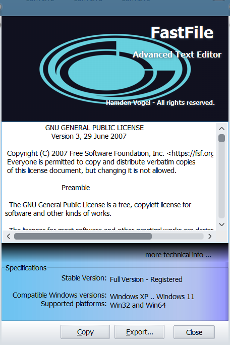

The branded **About** view shows the mark, copyright, and the full **GNU GPL v3** text, plus registered edition notes, Windows XP–11, and Win32/Win64.

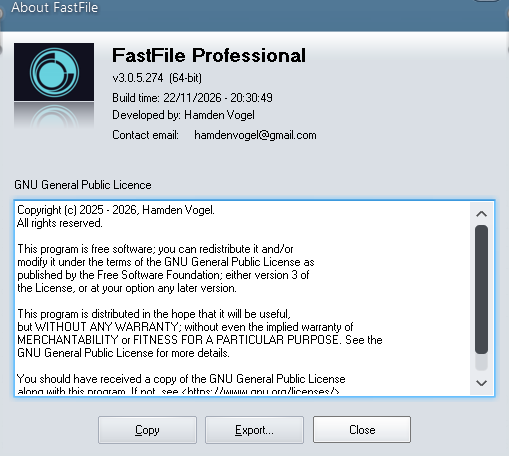

**About FastFile Professional** states **v3.0.5.274 (64-bit)**, build time, developer, and contact, with a short GPL notice and the same Copy / Export / Close actions.

---

## 11 — Search tools menu

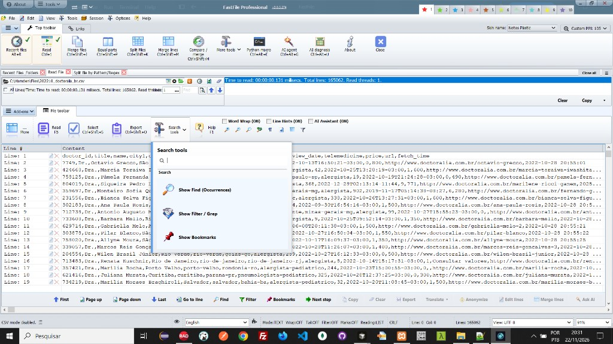

**Search tools** on the File toolbar opens Find (Occurrences), Filter / Grep, and Bookmarks in one menu (plus a quick find field). The same three actions also sit on the bottom strip of Read File.

---

## 12 — Find (Occurrences)

**Find** opens the **Occurrences** panel: type a term, Find, then Previous (Shift+F3) / Next (F3). Show all in list builds the full hit list; grep/glob open the command window. Here `allyne` lands on line 13 with the match highlighted; the status bar repeats the find message.

---

## 13 — Filter

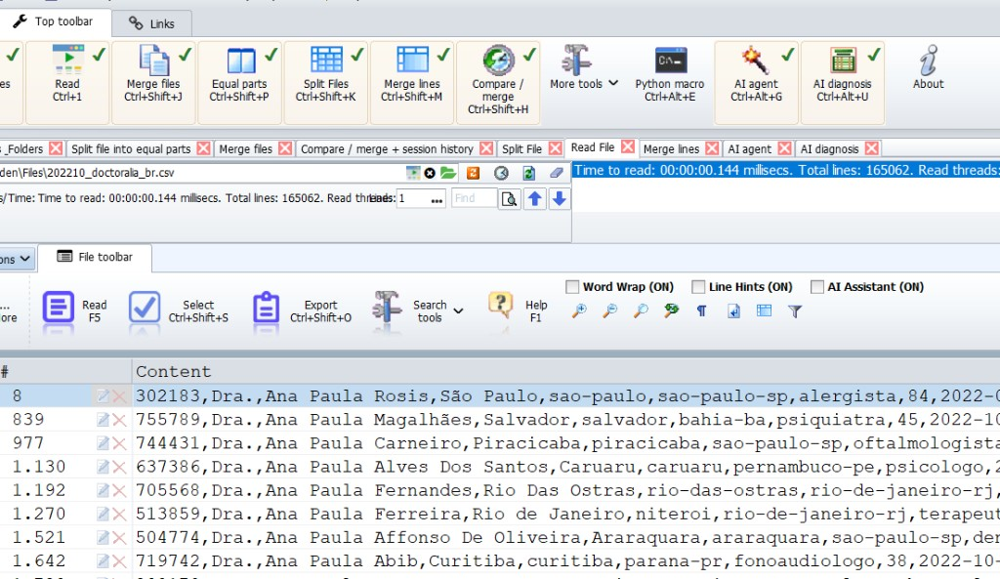

**Filter** keeps only rows that contain your text. Line numbers stay the original file indices. Example: `ana paula` leaves matching rows (8, 839, 977, …) visible; clear restores all 165,062 lines. Export and other line tools still apply to the filtered view.

---

## 14 — Built-in glob and grep

FastFile’s glob/grep window runs **inside the app** — no external shell. Type a command or describe the search; examples cover literals, whole words, inverted matches, bookmarked lines, and folder globs. **Generate with AI** drafts a command; nothing runs until you choose Run. Scans are cancellable; results are paged; Open returns to the line.

---

## 15 — Bookmarks

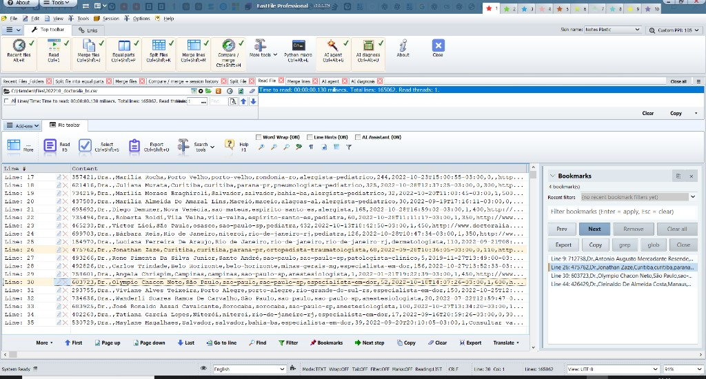

**Bookmarks** lists marked lines (Ctrl+B toggles; star in the margin). Prev/Next, Remove, Clear all, Export, Copy, grep/glob, and a filter box. Here lines 9, 26, 30, and 44 are marked. Grep can mark hits or search only marked lines (up to 10,000 bookmarks per indexed file).

---

## 16 — Compare / merge

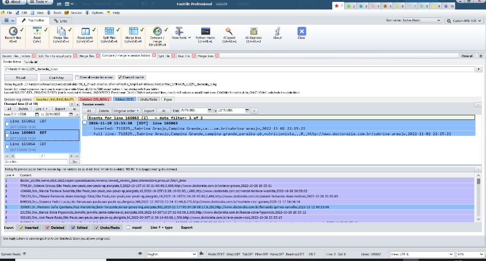

**Compare / merge (Ctrl+Shift+H)** shows session history: Inserted, Deleted, Edited, Undo/Redo, Equal. Changed lines and session events sit side by side; the preview colors context. **Apply** writes; equal rows are skipped.

---

## 17 — Equal parts

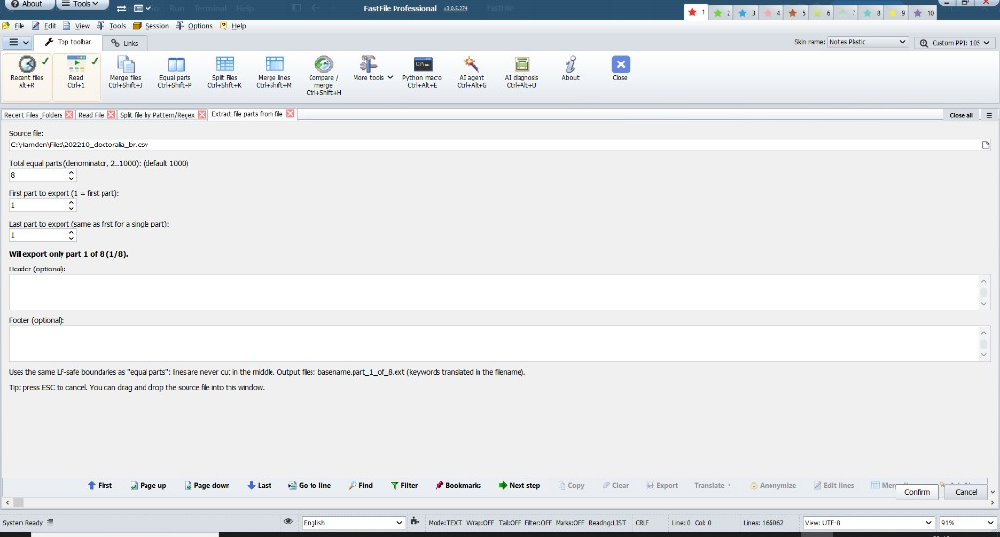

**Equal parts (Ctrl+Shift+P)** divides a source into N parts (2–1000) with optional header/footer. Boundaries are LF-safe; names follow `basename.part_N_of_M.ext`. Example: 8 parts, export part 1 of 8. Confirm writes; Cancel leaves the source alone.

---

## 18 — Split by lines

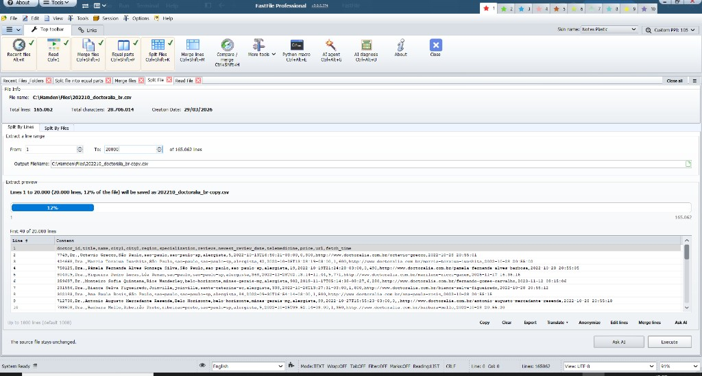

**Split files (Ctrl+Shift+K) › Split by Lines** copies a From–To range to a new file (here lines 1–20,000 ≈ 12% of the CSV). Preview uses the same line tools as the main list. **Execute** uses the line index and a background write — it does not load the whole file. Source stays unchanged.

---

## 19 — File created

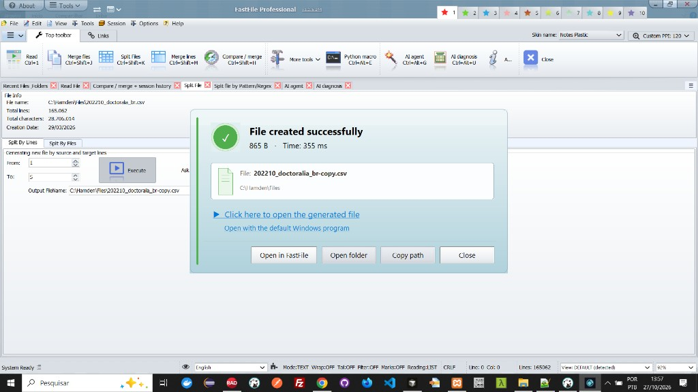

Shared success dialog after a split, export, or similar write: size, elapsed time, open in FastFile, open with Windows default, open folder, copy path. Multi-file runs list up to eight paths. Last generated file is remembered for the session.

---

## 20 — Merge files

**Merge files (Ctrl+Shift+J)** inserts a source into a destination (start, after a line, or end). Optional self-merge and source line range. Numbered `.part001`/`.part002` sets can be reunited in order. Checks existence and disk space, keeps an undo backup, then merges in the background. Ask AI / Confirm / Cancel before write.

---

## 21 — Merge lines

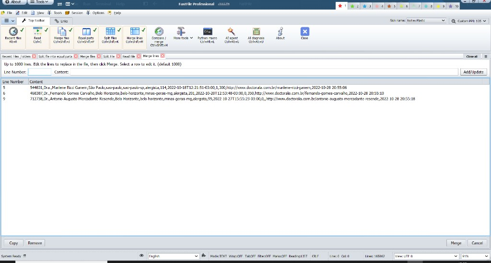

**Merge lines (Ctrl+Shift+M)** stages replacements by line number (default limit 1000). Add/Update builds the list; Merge applies; Cancel discards. Use when you know the line numbers and want a clear review list first.

---

## 22 — Split by Pattern / Regex

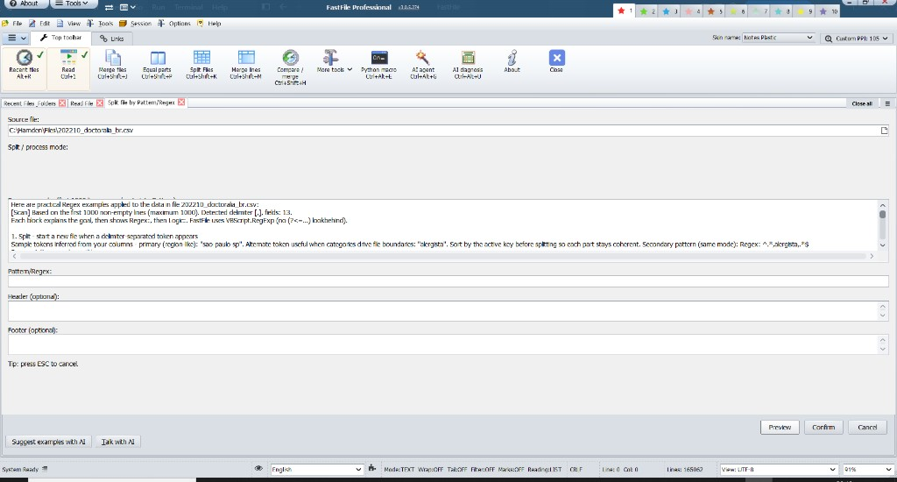

Starts a new output file when a line matches a pattern or regex. Samples the first 1,000 non-empty lines (here: comma, 13 fields); engine is **VBScript.RegExp** (no lookbehind). Suggest / Talk with AI can propose patterns; Preview then Confirm.

---

## 23 — More tools

**More tools** gathers Pattern/Regex, Equal parts, Extract parts, Find Files, and **Select skin** (these screenshots use Notes Plastic).

---

## 24 — Python macros

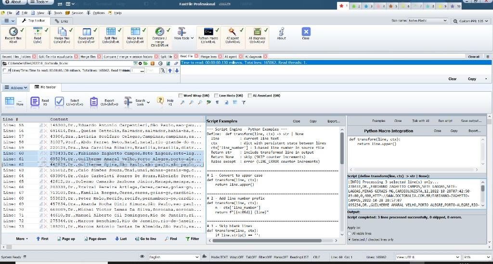

**Python macro** on Read File: lines, Script Examples, and the editor. Write `transform(line, ctx)` — return a string to keep the line, or nothing to drop it. Scope: all visible or selected/checked lines. Examples, Talk with AI, Run script, Save output. Example: three selected lines with `return line.upper()`.

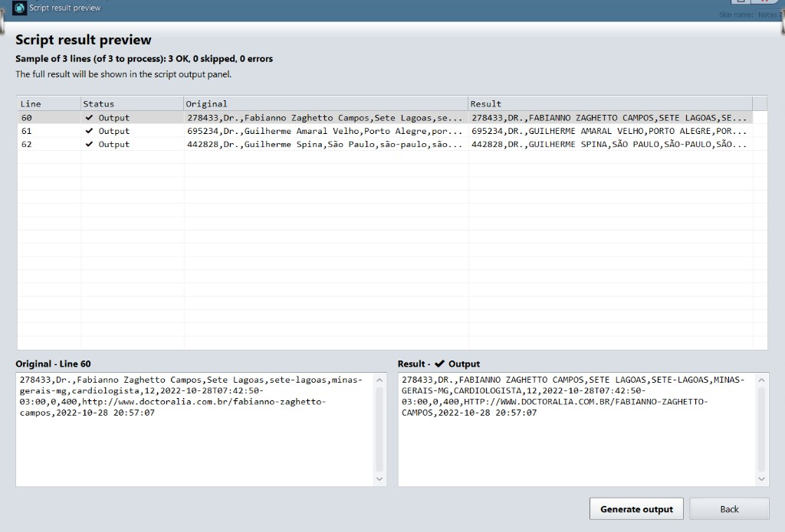

**Script result preview** samples the run (here 3 OK), shows Original vs Result, then Generate output or Back. Full output goes to the script panel.

---

## 25 — Tail mode

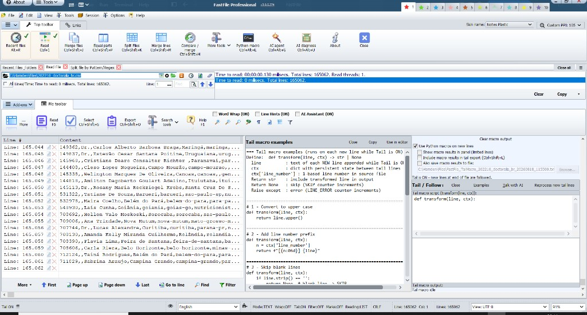

With **Tail** on, Read File follows a growing file. Tail macro examples and Talk with AI sit beside the list; optionally apply Python to new lines and reprocess. Same `transform` contract as the macro panel, on lines that arrive while you follow.

---

## 26 — AI diagnosis

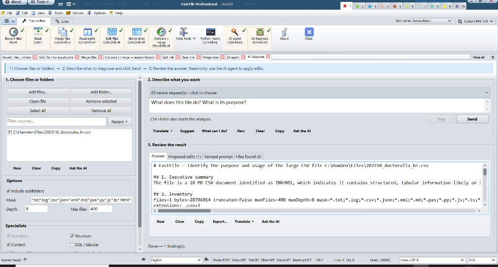

**AI diagnosis (Ctrl+Alt+U)** — choose sources, describe the question, review the answer. Specialists (Inventory, Content, Structure, SQL / tabular, …) focus the review. **Diagnosis does not change files**; edits go through the AI agent after accept.

---

## 27 — AI agent

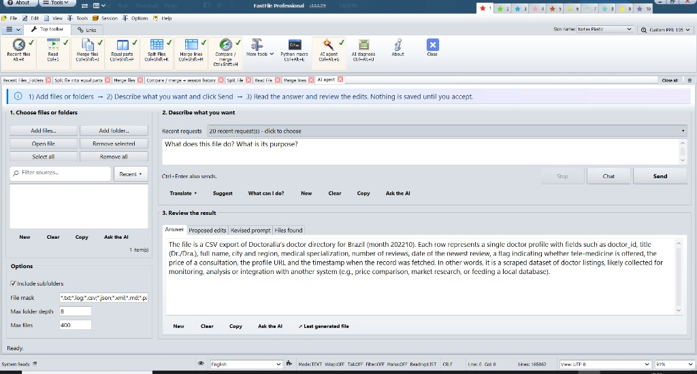

**AI agent (Ctrl+Alt+G)** — add sources, send a request, review Answer / Proposed edits / Revised prompt / Files found. Proposals stay proposals until you accept. Only selected sources are in scope.

---

## 28 — Extract Frequent Strings

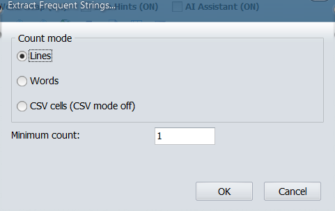

**Tools › Filter and analysis › Extract Frequent Strings…** writes `string,count` for Lines, Words, or CSV cells, with a minimum count. Uses an MMF line scan (in-memory map or bucket spill) so large files need not load fully into RAM.

---

## 29 — Delete Duplicate Lines

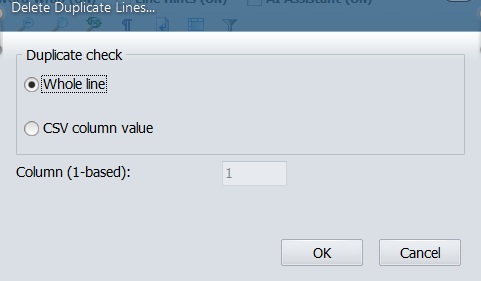

**Delete Duplicate Lines…** keeps the first copy of each key (**Whole line** or **CSV column**). Progress shows size, throughput, and ETA; disk space is checked before rewrite.

---

## 30 — Anonymize data

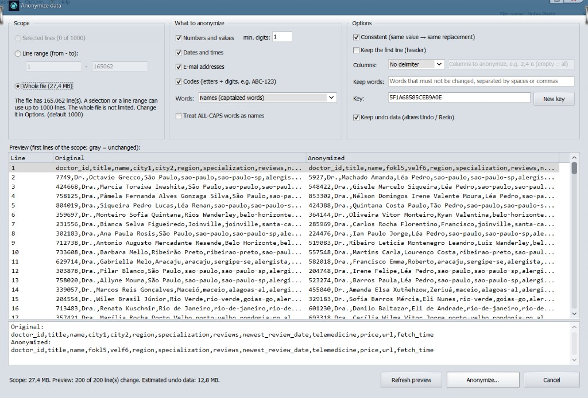

**Anonymize (Ctrl+Alt+D)** replaces sensitive values with same-shaped fakes. Scope: selection, range, or whole file. Options: numbers, dates, emails, codes, names; consistent mapping; undo data. Preview Original vs Anonymized before **Anonymize…**.

---

## 31 — Insert multiple lines

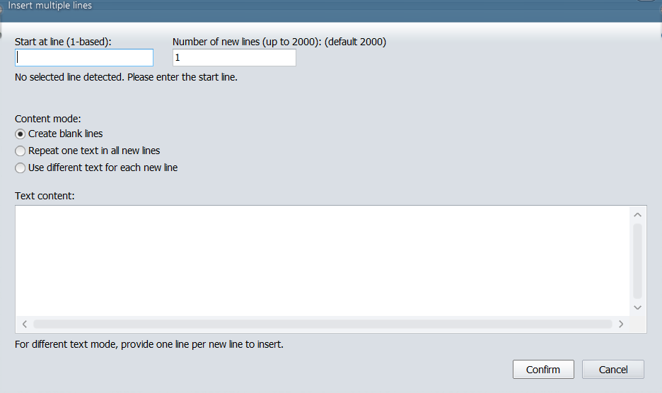

Insert at a 1-based start line: blank lines, one repeated text, or different text per line (up to the configured default, e.g. 2000). Confirm writes; Cancel does not.

---

## 32 — CSV / Column mode

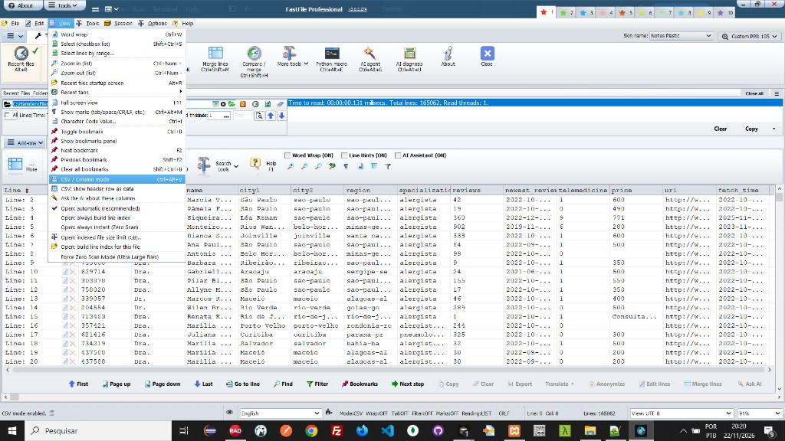

**View › CSV / Column mode (Ctrl+Alt+V)** shows delimited files as a grid (headers as columns). Status: **Mode: CSV**. Related: show header as data, Ask the AI about these columns, Open / Zero Scan policy.

---

## 33 — Preferences

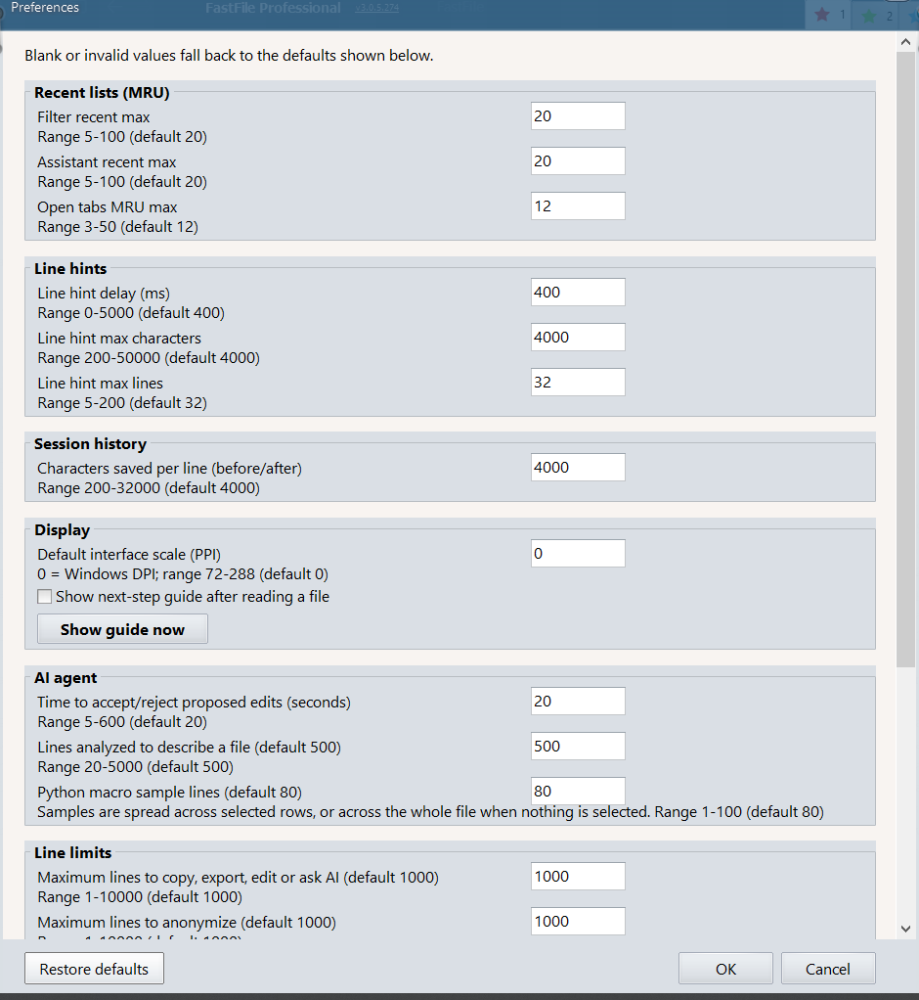

**Preferences** exposes MRU sizes, line hints, session history length, display PPI, AI agent timeouts/samples, and line limits for copy/export/edit/Ask AI/anonymize — each with range and default. Blank values fall back to defaults. Restore defaults / OK / Cancel.

---

## 34 — Session menu

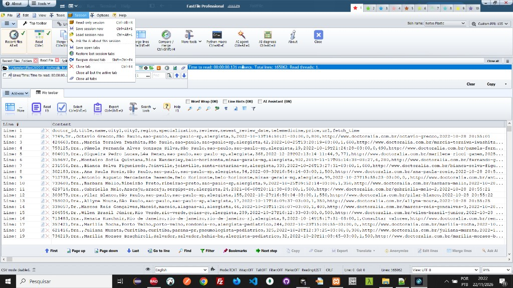

**Session**: read-only (Ctrl+Alt+R), save/load now, ask the AI about the session, and close tabs. Keeps browse/search safe when disk writes should stay blocked.

---

## Also on the main toolbar

Same rule everywhere: **review the plan, then write.**

| Action | What it is for |
|---|---|
| Export | Copy the current view or a result list out of FastFile. |
| Skins | Notes Plastic and other AlphaSkins from the toolbar list. |

---

## Summary

FastFile Professional combines a **big-file engine** (index + MMF, optional Instant Open) with **safe edits**, **search and reshape tools**, **Python**, and **AI that stays under your review**. It is built for people who open production-size text every day and need the machine to stay usable.

**FastFile Professional 3.0.5.274** — native Windows · 30 languages · skins and PPI · production-size text.
