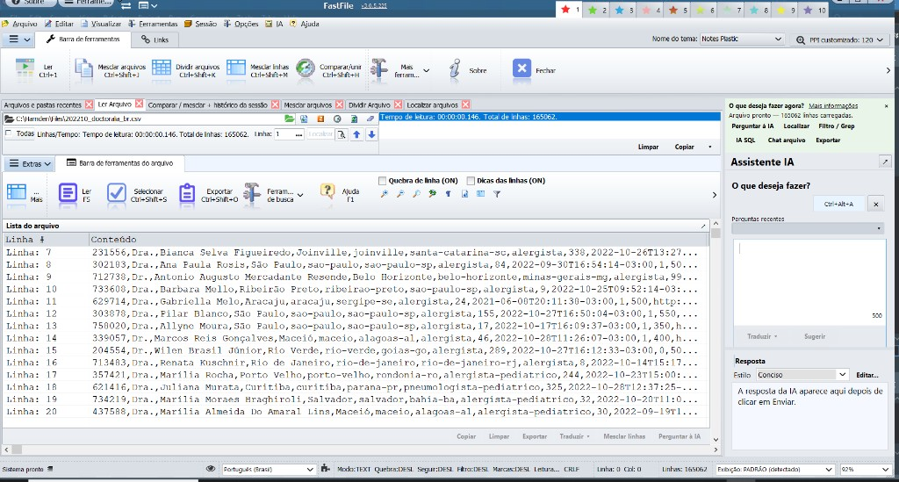

# FastFile Professional

**The professional tool to open, search and edit multi-gigabyte text files instantly on Windows.**

**FastFile Professional** is a native, professional-grade Windows desktop tool written in Delphi for working
with very large text files (logs, CSV/TSV exports, SQL dumps, data extracts) that make ordinary editors freeze
or run out of memory. Files are indexed by line and read through memory-mapped I/O, so a 10 GB file opens and
scrolls as smoothly as a 10 KB one.

> **Edition: Professional.** FastFile is not a hobby viewer: it is a professional product built for analysts,
> DBAs, developers and support teams who handle production-size data every day — with safe atomic writes,
> a full change journal, an AI agent with reviewed proposals, data anonymization and 14 UI languages.



## Professional features

- **Huge files, instantly** – line index + memory-mapped files (MMF); *Zero Scan* mode opens giant files without a full pre-scan.
- **Search and replace** – fast find, filters, Replace All in segmented mode for files larger than RAM.
- **Internal glob / grep** – path wildcards or content searches, cancellable paged results and bookmark integration; separate buttons in Find, Filter and Bookmarks. Type just `grep` or `glob` for examples and optional AI command help. Review generated commands before running them.
- **Edit safely** – line editing, batch delete, atomic writes (temp file + swap) and a session history journal.
- **File tools** – split, merge, compare (line diff engine) and extract parts of a file.
- **Navigation** – bookmarks, go to line, filtered views, zoom.
- **Python macros** – run scripts against the open file through the built-in script engine.
- **AI assistant** – ask questions about the file content (optional Python companion).
- **AI agent on files** (Ctrl+Alt+G) – describe a request in plain words or SQL (`SELECT … GROUP BY / SUM / COUNT`, `UPDATE`, `DELETE`…) over one or many files; every change is shown as a proposal and only written after you accept it, within a configurable time limit. It can profile each file, follow which files you named, and run a Python macro on each line after a preview.
- **AI diagnosis** (Ctrl+Alt+U) – read-only review of files and folders (inventory, structure, content, SQL, privacy, actions). Edits stay on the AI agent.
- **Fast line edit** – insert, replace and delete on large files through the existing line index, with a journal that restores the file if the app stops mid-edit, and a before/after preview of the lines that change.
- **Anonymize data** (Ctrl+Alt+D) – replace private values with fake ones of the same type and length, with preview and undo.
- **Session history details** – before/after of every change, field-by-field compare, export to TXT/CSV/JSON.
- **Source check** – JSON, HTML and SQL inside FastFile; Java, Go and C# with the compiler already on this PC.

Current version: **FastFile Professional 3.0.5.244** (2026-10-24) — see [src/CHANGELOG_IMPLEMENTACOES.md](src/CHANGELOG_IMPLEMENTACOES.md).
- **14 languages** – English, Português (BR/PT), Español, Français, Deutsch, Italiano, Polski, Română, Magyar, Čeština, 日本語, 简体中文, 繁體中文.
- **Skinnable UI** – AlphaSkins themes and adjustable UI scaling (PPI) for high-DPI monitors.

## glob / grep quick start

```text
grep "casa"
grep -i "casa" --limit 500
glob "*.txt"
grep "casa" "C:\dados\arquivo grande.txt"
glob "*.txt" "C:\dados\arquivo grande.txt"
```

The file operand is **optional**: main-window/Assistant/typed-agent commands use
the filename field first. An explicit file is validated and loaded before the
command runs; invalid paths produce errors. `glob` matches paths, not content.
AI-generated suggestions never execute automatically; diagnosis/model tools
remain restricted to their authorized sources.

Content searches read blocks, stop at the hit cap and report partial results.
Each physical line is limited to **16,777,216 decoded characters**, with an
explicit error on overflow. Sparse **80 GiB** regression fixtures verify
64-bit positions, glob, early-hit termination, cancellation and GUI Instant
Open—not full-file throughput. The existing opening policy is preserved:
choose **Instant Open** to avoid initial indexing of giant files.

See the [full command guide](src/README.md#internal-glob--grep-commands)
and general **F1** help (14 languages). Internal history entries **.240–.243**
separate commands, modal AI, launchers and optional-file/large-file validation.

## Requirements

| Item | Details |
|------|---------|
| OS | Windows 7 or later (Win64 recommended; Win32 also supported) |
| IDE | Embarcadero Delphi 10.4.2 Sydney (`src/FastFile.dproj`). Legacy Delphi 7 build is still kept (`src/FastFile.dpr`). |
| AlphaControls | Commercial VCL suite – **not included** in this repository. Expected at `..\..\acnt_reg` relative to `src` (see `DCC_UnitSearchPath` in the project). Get it from [alphaskins.com](https://www.alphaskins.com/). |
| FindFile | Component expected at `..\..\Findfile` relative to `src`. |
| FastMM4 / FastCode | Included (`src/FastMM4-master`, `src/FastCode.Libraries-0.6.4`). |

## Building

1. Install AlphaControls and make sure the paths above resolve (or adjust the unit search path in the project options).
2. Open `src/FastFile.dproj` in Delphi 10.4.2.
3. Select platform **Win64** (or Win32) and build.
4. The executable is written to `src/Build/<Platform>/FastFile.exe`.

Command-line build:

```bat
call "C:\Program Files (x86)\Embarcadero\Studio\21.0\bin\rsvars.bat"
cd src
msbuild FastFile.dproj /t:Build /p:Config=Release /p:Platform=Win64
```

On first run FastFile Professional extracts its default configuration (`ASkin.ini`), skins and assets from embedded
resources into the executable folder.

## Repository layout

| Path | Contents |
|------|----------|
| `src/` | Delphi sources, forms, resources and the project files |
| `src/README.md` | Detailed technical documentation (architecture, threading, indexing, INI keys, AI plugins) |
| `Skins/` | AlphaSkins themes |
| `Images/`, `Resources/` | Icons and image assets |
| `Docs/` | Notes and documentation |
| `tools/` | Helper scripts (i18n, encoding maintenance) |

## Documentation

See **[src/README.md](src/README.md)** for in-depth technical documentation: core units, threading model,
index file format, Zero Scan decision logic, atomic writes, diff engine, internationalization and
configuration keys.

## License

See [src/LICENSE](src/LICENSE).

Copyright © 2025–2026 Hamden Vogel.
